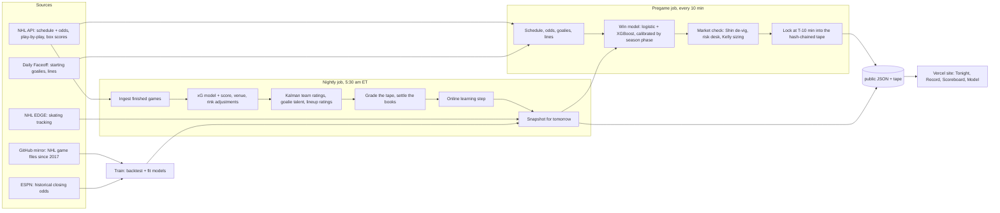

# Blue Line Capital 
(Link: blue-line-capital-site-v5y2-70jg5ip9w.vercel.app )

A machine-learning model that picks the winner of every NHL regular-season game (overtime and
shootouts included), locks each pick 10 minutes before puck drop in a tamper-evident ledger, and
grades itself against the betting market with five simulated bankrolls. Everything runs on its own:
GitHub Actions collects the data, trains, predicts and publishes; Vercel serves the site.


Each season was replayed one day at a time by a model trained only on seasons at least two years
older, learning after every game exactly as it does live.

| Season | Games | Picks right | Log loss | Always-pick-home log loss |
|---|---|---|---|---|
| 2023-24 | 1,312 | 60.6% | 0.664 | 0.690 |
| 2024-25 | 1,312 | 57.6% | 0.668 | 0.687 |
| 2025-26 | 1,312 | 55.6% | 0.685 | 0.693 |
| **All** | **3,936** | **58.0%** | **0.672** | **0.689**| 

Log loss grades probabilities (lower is better; 0.693 is a coin flip).

Against the closing betting line on the same 3,936 games, the market got 59.3% right with a log
loss of 0.665, so the model trails it slightly (58.0%, 0.672) and beat it only in 2025-26 on
accuracy. Every simulated betting strategy lost roughly the bookmaker's margin over the three
seasons. That's the honest baseline the live season is measured against.

## How it works



The full explanation of every part, with the math and interview talking points, is in
[LEARN.md](LEARN.md).


What's where

```
pipeline/          the model and the jobs (Python)
  config.py        every setting in one place
  parse_game.py    raw NHL game JSON -> shots, events, players
  xg_model.py      expected goals
  team_stats.py    score/venue and rink adjustments
  ratings.py       Kalman filter power ratings
  goalies.py       goalie talent + streak test
  players.py       Game Score lineup ratings
  features.py      the 25 model inputs
  win_model.py     logistic regression + XGBoost, calibration, online learning
  backtest.py      walk-forward exam (+ market comparison)
  market.py        odds, Shin de-vig, risk desk, Kelly, books
  tape.py          hash-chained ledger
  live.py          tonight's predictions
  run.py           command line (what GitHub Actions calls)
  publish.py       writes public/*.json for the site
site/              the website (static HTML/CSS/JS, GSAP, self-hosted fonts)
data/tables/       every game since 2017-18 as parquet tables
state/             trained models, snapshot, record
tape/              locked predictions, one line each
public/            what the site reads
tests/             end-to-end test of the live loop
```

The bankroll is simulated and nothing here is betting advice.
